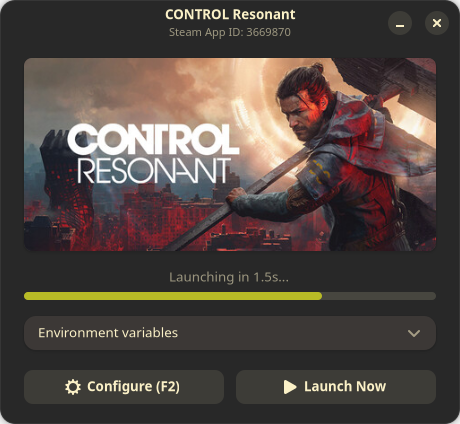
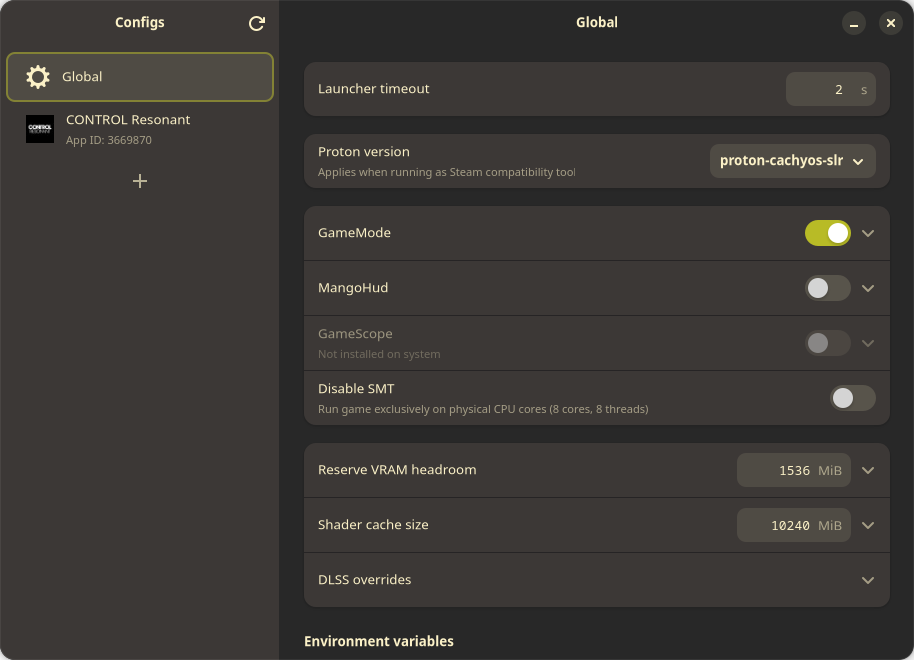
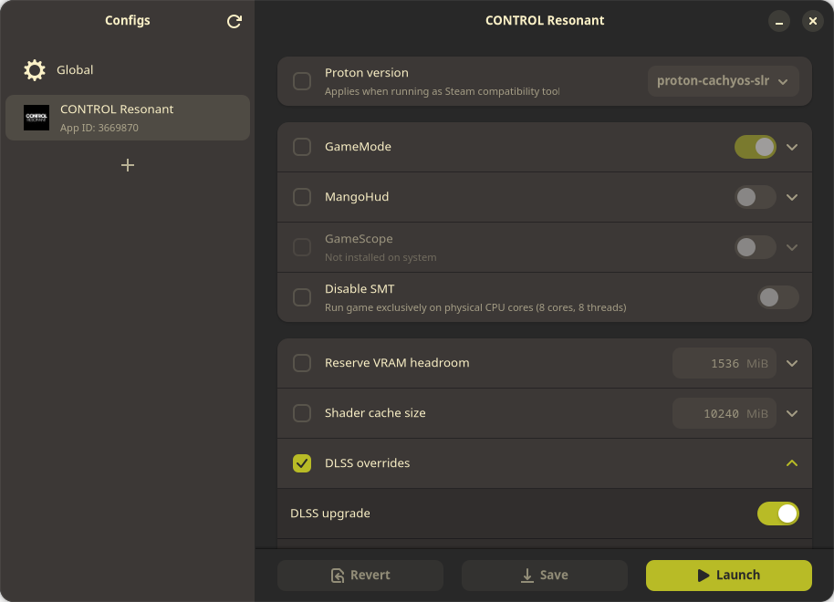
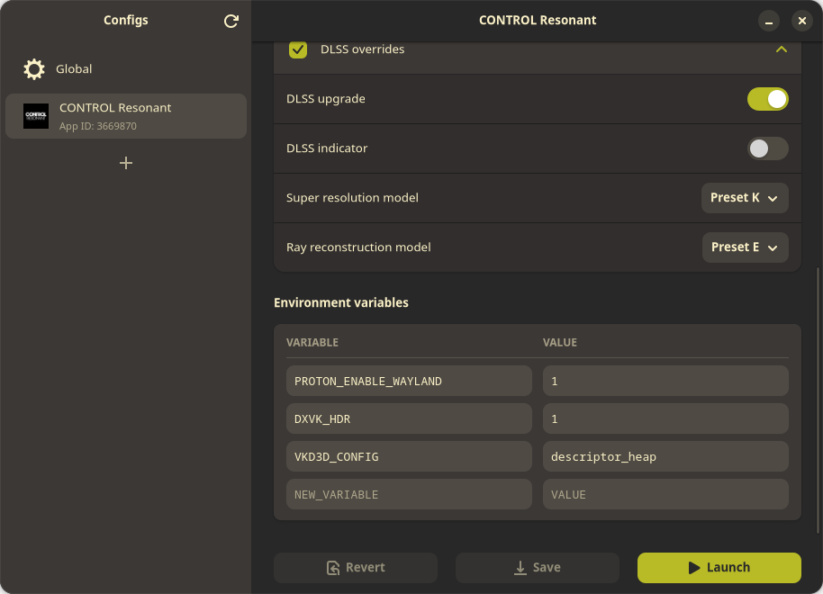
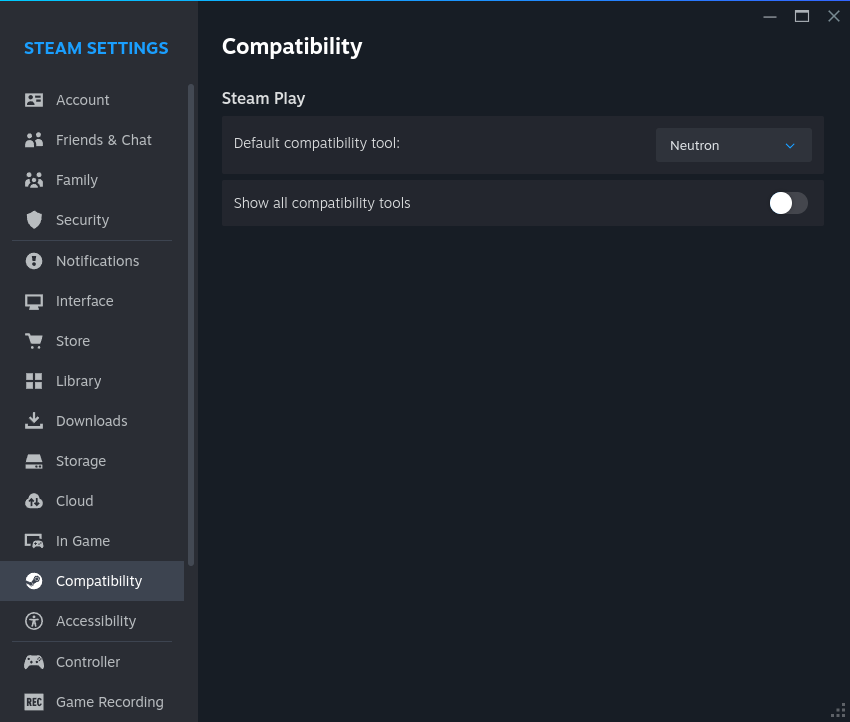
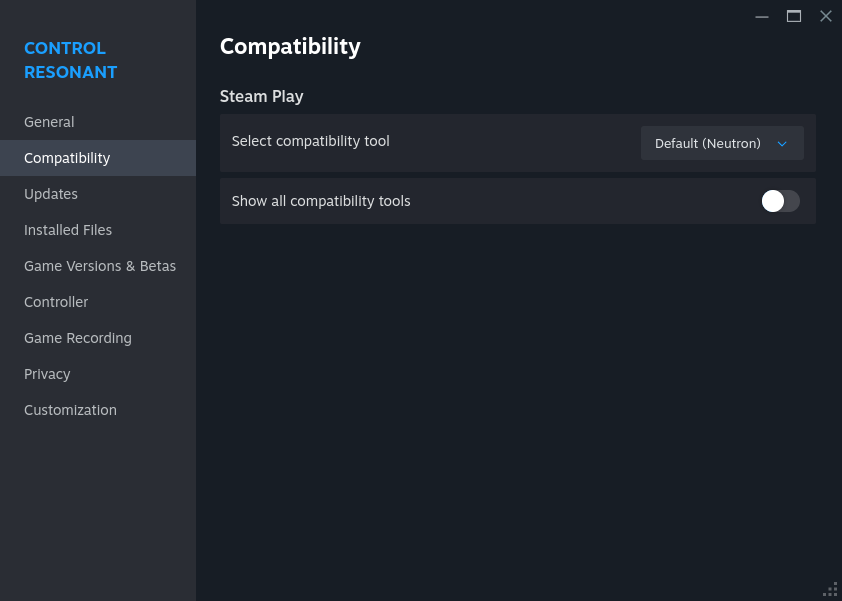

# Neutron

A fast, native **Rust + GTK4 / Libadwaita** application for managing per-game Steam Proton compatibility versions, wrappers, and environment variable overrides — complete with a pre-launch countdown window.

<p align="center">
  <a href="docs/screenshots/launcher-countdown.png" target="_blank" rel="noopener noreferrer">
    
  </a>
</p>

<div align="center">
  <table>
    <thead>
      <tr>
        <th align="center">Global Configuration</th>
        <th align="center">Per-Game Overrides &amp; Launch</th>
        <th align="center">DLSS Overrides &amp; EnvVar Table</th>
      </tr>
    </thead>
    <tbody>
      <tr>
        <td align="center">
          <a href="docs/screenshots/manager-global.png" target="_blank" rel="noopener noreferrer">
            
          </a>
        </td>
        <td align="center">
          <a href="docs/screenshots/manager-game.png" target="_blank" rel="noopener noreferrer">
            
          </a>
        </td>
        <td align="center">
          <a href="docs/screenshots/manager-game-envvars.png" target="_blank" rel="noopener noreferrer">
            
          </a>
        </td>
      </tr>
    </tbody>
  </table>
</div>

<p align="center">
  <sub>Click any screenshot to open the full-resolution image.</sub>
</p>

---

## Features

Neutron acts as a **Steam Compatibility Tool** (or Launch Options wrapper) paired with a standalone **Settings Manager**:

- **Settings Manager (`neutron`)**: Configure global defaults (`~/.config/neutron/global.env`) and per-game overrides (`~/.config/neutron/<app_id>.env`) with automatic Steam game title & icon resolution.
- **Managed Properties** (each supports per-game inheritance or override):
  - **Launcher timeout** *(global)*: Configures the pre-launch countdown window duration in seconds (`0` skips the window and launches immediately).
  - **Proton version**: Selects which discovered Proton build runs the game when using Neutron as a Steam compatibility tool.
  - **GameMode**: Wraps game execution with Feral `gamemoderun` when installed.
  - **MangoHud**: Toggles `MANGOHUD=1` with an inline editor for `MANGOHUD_CONFIG`.
  - **GameScope**: Wraps the game in `gamescope` with customizable arguments (and a button to insert auto-detected display/refresh defaults).
  - **Disable SMT**: Pins the game process to physical CPU cores via `taskset`, excluding SMT/Hyper-Threading sibling threads.
  - **Reserve VRAM headroom**: Limits reported Vulkan VRAM via `VK_LAYER_MESA_vram_report_limit` by subtracting a configurable MiB buffer from total GPU VRAM.
  - **Shader cache size**: Sets the GPU shader disk cache limit in MiB (`__GL_SHADER_DISK_CACHE_SIZE` / `MESA_SHADER_CACHE_MAX_SIZE`, or disables it when set to `0`).
  - **DLSS overrides**:
    - **DLSS upgrade** (`PROTON_DLSS_UPGRADE`): Enables automatic DLSS DLL upgrades.
    - **DLSS indicator** (`DLSSIndicator=1024,DLSSGIndicator=2`): Shows the on-screen DLSS debug indicator.
    - **Super resolution model**: Selects the DLSS Super Resolution render preset.
    - **Ray reconstruction model**: Selects the DLSS Ray Reconstruction render preset.
    - **Frame generation model**: Selects the DLSS Frame Generation render preset (shown when supported by the GPU).
- **Environment Variable Editor**: Add, edit, toggle (enable/disable without deleting), inspect inherited global variables, and track unsaved changes.
- **Pre-Launch Window**: Brief configurable countdown before launching a game with **Configure (F2)** to jump straight into that game's settings, **Launch Now** (`Enter` / `Space`), or **Cancel** (`Esc`).

---

## Installation

### Arch Linux / CachyOS (Prebuilt `pacman` Package)

Download `neutron-<version>-1-x86_64.pkg.tar.zst` from the [GitHub Releases](https://github.com/romulof/neutron/releases) page and install it with `pacman`:

```bash
sudo pacman -U neutron-*-x86_64.pkg.tar.zst
```

You can also build and install the Arch package directly from source via [packaging/arch/PKGBUILD](packaging/arch/PKGBUILD) (`makepkg -si`).

### Arch Linux / CachyOS (AUR — *Pending*)

> **Note:** `neutron-bin` and `neutron-git` are not yet published on the AUR while new AUR registrations are closed (tracked in [#1](https://github.com/romulof/neutron/issues/1)). The `neutron` package name is reserved for future official Arch Linux repository packaging. Once published to AUR, they will be installable via `yay -S neutron-bin` / `paru -S neutron-bin` (or `neutron-git`). In the meantime, use the prebuilt `pacman` package above or `makepkg -si`.

### Standalone AppImage

Download `Neutron-<version>-x86_64.AppImage` from [GitHub Releases](https://github.com/romulof/neutron/releases) *(requires `glibc >= 2.39`, e.g. Arch/CachyOS, Ubuntu 24.04+, Fedora 40+; requires `libfuse2` unless `APPIMAGE_EXTRACT_AND_RUN=1` is set)*:

```bash
chmod +x Neutron-*-x86_64.AppImage
./Neutron-*-x86_64.AppImage
```

#### Using the AppImage with Steam

- **Launch Options mode** (works for both native and Proton games):
  ```text
  /path/to/Neutron-<version>-x86_64.AppImage launch %command%
  ```
- **Steam Compatibility Tool mode**:
  Install the compatibility tool manifest and symlink the AppImage into Steam's `compatibilitytools.d`:
  ```bash
  mkdir -p ~/.local/share/Steam/compatibilitytools.d/neutron
  ln -sf /path/to/Neutron-<version>-x86_64.AppImage ~/.local/share/Steam/compatibilitytools.d/neutron/neutron
  curl -fsSL https://raw.githubusercontent.com/romulof/neutron/main/compat/compatibilitytool.vdf \
    -o ~/.local/share/Steam/compatibilitytools.d/neutron/compatibilitytool.vdf
  curl -fsSL https://raw.githubusercontent.com/romulof/neutron/main/compat/toolmanifest.vdf \
    -o ~/.local/share/Steam/compatibilitytools.d/neutron/toolmanifest.vdf
  ```
  Restart Steam and select **Neutron** under **Steam Settings -> Compatibility**.

### Manual Installation (`make`)

To build and install Neutron system-wide (`/usr`) or for your current user (`~/.local`):

```bash
# System-wide installation (requires sudo)
make build
sudo make install PREFIX=/usr

# User-local installation (binary, desktop entry, icons, and Steam compat tool)
make install-user
```

### Usage

Choose **one** of the two Steam integration modes below depending on your game, or run the **Settings Manager** standalone anytime:

#### Option A: Steam Compatibility Tool *(Recommended for Proton games)*

Select **Neutron** in **Steam Settings -> Compatibility** (or game **Properties -> Compatibility**). Steam invokes `neutron waitforexitandrun <game.exe>`, and Neutron manages the selected Proton version, Steam Linux Runtime, wrappers, and environment overrides.

<div align="center">
  <table>
    <thead>
      <tr>
        <th align="center">Steam Global Compatibility</th>
        <th align="center">Per-Game Compatibility</th>
      </tr>
    </thead>
    <tbody>
      <tr>
        <td align="center">
          <a href="docs/screenshots/steam-settings-compatibility.png" target="_blank" rel="noopener noreferrer">
            
          </a>
        </td>
        <td align="center">
          <a href="docs/screenshots/steam-game-compatibility.png" target="_blank" rel="noopener noreferrer">
            
          </a>
        </td>
      </tr>
    </tbody>
  </table>
</div>

#### Option B: Steam Launch Options *(Alternative — works for native Linux and Proton games)*

Instead of selecting Neutron as a compatibility tool, set a game's Launch Options in Steam to:

```text
neutron launch %command%
```

*(Note: In this mode, Steam selects and resolves Proton before Launch Options run, so Neutron's Proton version selector does not apply.)*

#### Standalone Settings Manager

Run `neutron` from your application launcher or terminal to configure global defaults and per-game overrides directly.

---

## Building

### Prerequisites

- **Rust toolchain** (edition 2024, `cargo`, `rustc`)
- **GTK4** (`>= 4.10`) and **Libadwaita** (`>= 1.5`) development headers

<details>
<summary>Install build dependencies by distribution</summary>

- **Arch Linux / CachyOS**:
  ```bash
  sudo pacman -S --needed rust gtk4 libadwaita hicolor-icon-theme base-devel
  ```
- **Ubuntu / Debian**:
  ```bash
  sudo apt-get install -y build-essential pkg-config libgtk-4-dev libadwaita-1-dev
  ```
- **Fedora**:
  ```bash
  sudo dnf install -y gcc pkg-config gtk4-devel libadwaita-devel
  ```

</details>

### Build & Run Tests

```bash
# Build release binary
make build

# Run formatting, Clippy, and unit tests
make check

# Run Settings Manager in dev mode
cargo run
```

### Building Packages Locally

- **Arch Linux package (`pacman`)**:
  ```bash
  cd packaging/arch
  makepkg -si
  ```
- **Standalone AppImage** *(additionally requires `patchelf`, `curl`, `file`, `desktop-file-utils`, `appstream`, and `librsvg2-dev`/`librsvg`)*:
  ```bash
  make appimage
  # Output: dist/Neutron-<version>-x86_64.AppImage
  ```

---

## Contribution

Contributions are welcome!

- **Conventional Commits**: This repository uses [Conventional Commits](https://www.conventionalcommits.org/) (`feat:`, `fix:`, `perf:`, `docs:`, `build:`, `ci:`, `refactor:`, etc.) to automate **Semantic Versioning** and **changelog generation** ([CHANGELOG.md](CHANGELOG.md)).
- **Code Quality**: Before submitting a pull request, ensure `make check` (`cargo fmt --check`, `cargo clippy --all-targets -- -D warnings`, and `cargo test --locked`) passes cleanly.

See [CONTRIBUTING.md](CONTRIBUTING.md) for commit guidelines and development workflow details.

## License

Licensed under the [MIT License](LICENSE).
